  

  
  
  
  
  
  

  <b>Financial Engineer</b> · Medellín, Colombia 
  Where finance meets data: I build models to <b>measure risk</b>, <b>optimize portfolios</b> and <b>forecast markets</b>.

## 📂 Projects

<table>
  <tr>
    <td width="50%" valign="top">
      <h3><a href="https://github.com/juanoscd/Portafolio-BVC">📊 Portafolio-BVC</a></h3>
      Portfolio optimization with Colombian stocks.  
      <code>Markowitz</code> <code>VaR / CVaR</code> <code>Monte Carlo</code> <code>Walk-forward</code>
    </td>
    <td width="50%" valign="top">
      <h3><a href="https://github.com/juanoscd/Series-de-tiempo-del-oro">🥇 Gold Time Series</a></h3>
      Modeling and forecasting gold volatility.  
      <code>ARIMA</code> <code>GARCH</code> <code>VAR</code> <code>Returns</code>
    </td>
  </tr>
</table>

## 🛠️ Stack

## 🧭 Career

